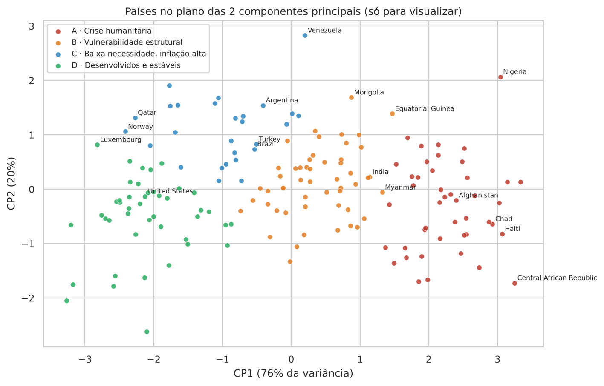

# 🌍 Priorização de ajuda humanitária com clusterização

Projeto da disciplina **Mineração de Dados** (Ciência de Dados e IA · PUC-SP · 2026.2).

Pergunta de negócio: **com um orçamento limitado, quais países deveriam receber ajuda humanitária primeiro?**
A partir de indicadores socioeconômicos de **167 países**, o projeto agrupa os países por perfil de necessidade e define uma ordem de atendimento.

   

## Resultado

Quatro grupos de países, encontrados com **K-Means** e confirmados pelo **agrupamento hierárquico (Ward)**:

| Grupo | Países | Mortalidade infantil (mediana, por mil) | Renda (mediana, US$) | Extrema pobreza (%) |
|---|---|---|---|---|
| **A · Crise humanitária** | 44 | 90,3 | 1.800 | 55,8 |
| **B · Vulnerabilidade estrutural** | 52 | 26,9 | 7.850 | 33,9 |
| **C · Baixa necessidade, inflação alta** | 27 | 10,8 | 20.100 | 16,5 |
| **D · Desenvolvidos e estáveis** | 44 | 4,6 | 30.000 | 9,0 |

O grupo A é o foco da recomendação. Dentro dele, um índice de necessidade ordena o atendimento — os primeiros são República Centro-Africana, Haiti, República Democrática do Congo, Níger e Chade (`saidas/prioridade_grupo_A.csv`).



## Etapas do pipeline

1. Carga, perfilamento e qualidade dos dados (duplicatas, tipos, identificador)
2. Faltantes disfarçados e valores impossíveis → NaN
3. Imputação: média × mediana × **KNN** (validada com dados mascarados)
4. Outliers: detecção por z-score e IQR, com decisão documentada
5. Assimetria: transformação log
6. EDA e correlação de Pearson → escolha de 4 indicadores
7. Escalonamento: Min-Max × Z-score × Robust
8. Métrica de distância
9. **K-Means**: cotovelo, silhueta, Calinski-Harabasz, Davies-Bouldin e estabilidade (ARI)
10. **Hierárquico**: critérios de ligação, dendrograma e corte
11. Perfis dos grupos e recomendação

## Como executar

```bash
pip install -r requirements.txt
python pipeline_projeto1.py          # gera tudo na pasta saidas/
# ou abra pipeline_projeto1.ipynb no Jupyter
```

## Arquivos

| Arquivo | Descrição |
|---|---|
| `pipeline_projeto1.ipynb` | Notebook completo, com gráficos e explicações |
| `pipeline_projeto1.py` | Mesmo pipeline em script |
| `paises_help_international.csv` | Base de dados de entrada |
| `saidas/` | Tabelas e figuras geradas (grupos, métricas, dendrograma, PCA) |

---

Autor: **Lucas Ambra Cordeiro** · [LinkedIn](https://www.linkedin.com/in/lucas-ambra)
